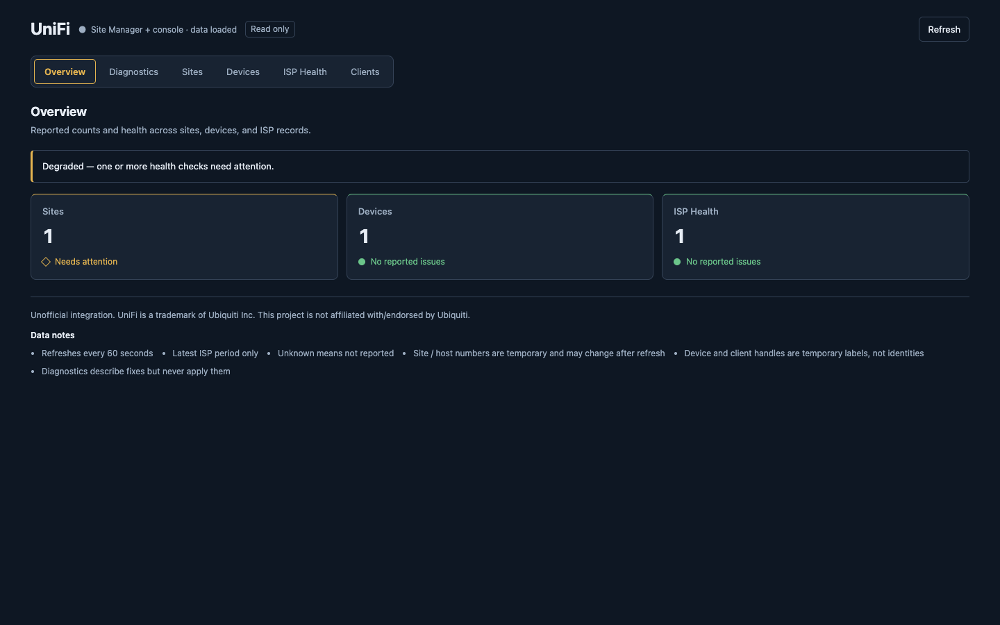
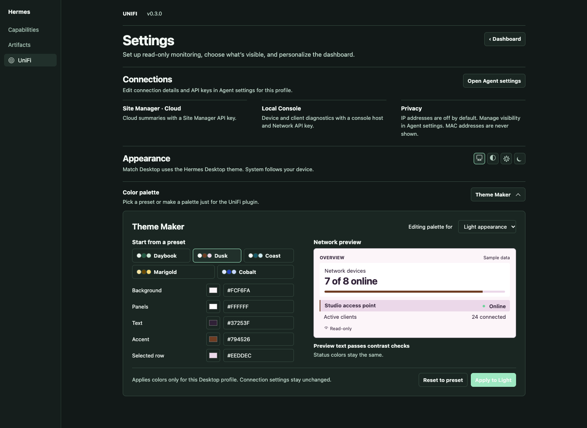
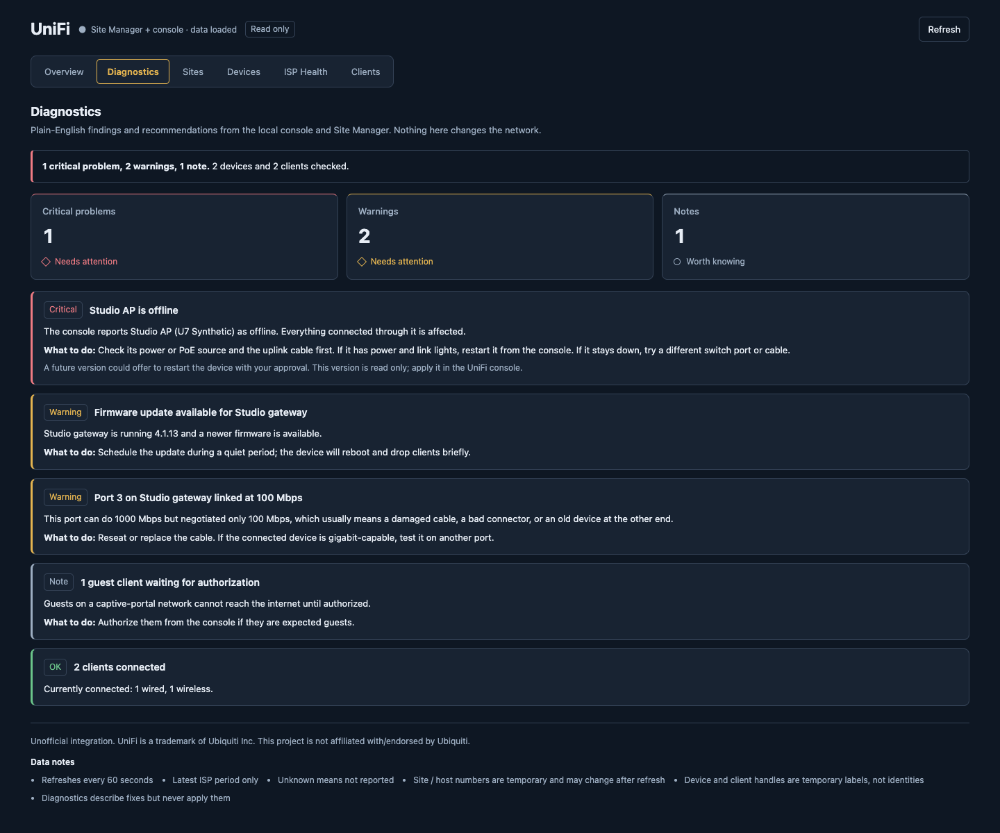
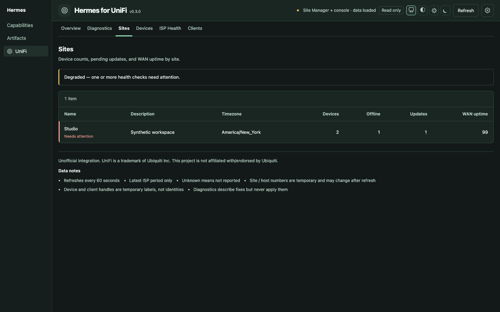
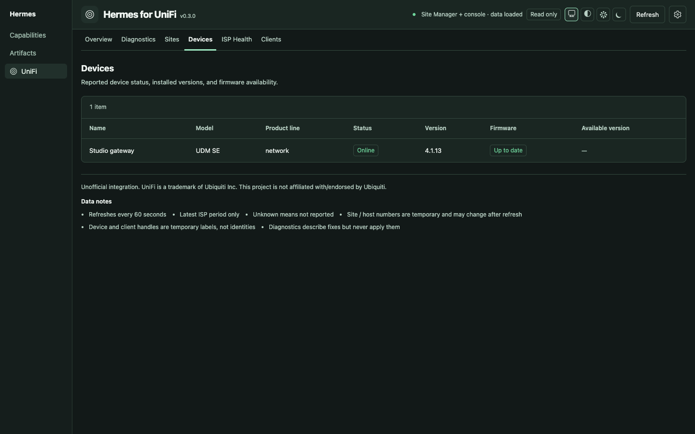
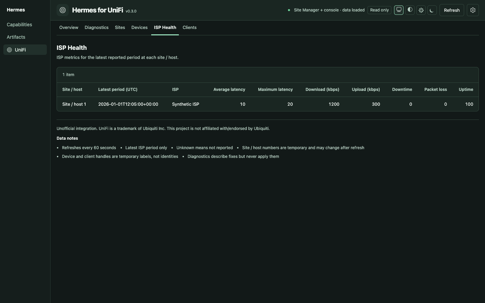
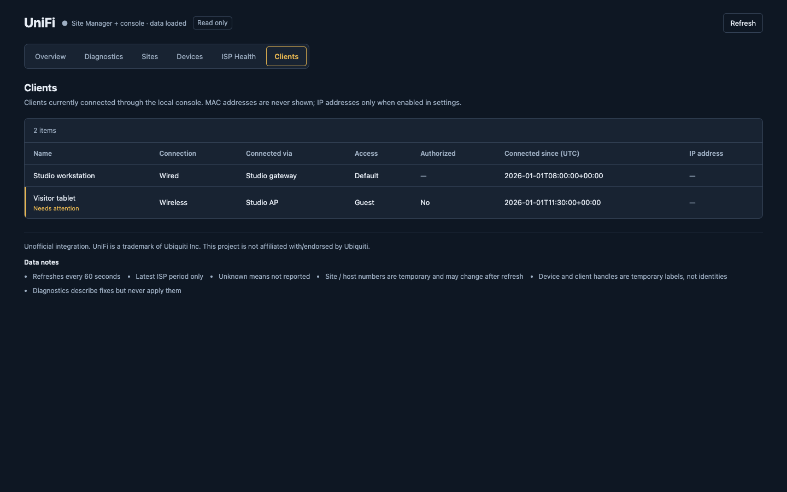

# Hermes for UniFi

See what's online, who's connected, and why a port or access point might need attention without leaving Hermes Desktop. Hermes for UniFi is a read-only monitor and troubleshooting assistant. It uses the official UniFi Site Manager API for cloud summaries and, optionally, the official UniFi Network API for local diagnostics and a Clients tab. It can suggest what to check, but it cannot change the network.

[Install in Hermes](hermes://plugin/install?repo=Anunnaki-Astronaut/hermes-unifi&enable=1) · [Setup guide](docs/INSTALL.md)



## What it shows

- Overview counts and reported health flags (Site Manager)
- Diagnostics explains what it found and what to check next in plain English (console + Site Manager).
- Sites, device totals, offline counts, and available updates (Site Manager)
- Device state, model, installed firmware, and firmware availability (Site Manager)
- The latest timestamped 5-minute ISP metric period per site/host pair (Site Manager)
- Clients currently connected, how they connect, and guest authorization (console)

The page refreshes every 60 seconds. Unknown means not reported; missing values appear as an em dash.

Open the gear in the dashboard for connection settings and appearance. Match Desktop is the default. You can also follow the system, pick light or dark, or use Theme Maker to create a palette just for UniFi.



## What the diagnostics check

Offline, isolated, or interrupted devices; firmware updates available; CPU and memory pressure; recent restarts and late check-ins; Wi-Fi retry rates; 2.4 GHz channel width and channel choice; access points sharing a channel; ports negotiated at 100 Mbps or less on faster hardware; PoE-limited ports; open or WPA2-only Wi-Fi; missing WAN; ISP packet loss, downtime, and latency; guests waiting for authorization; and clients last seen on a device that is down. Each finding says what is wrong, why it matters, and what to do.

When a finding has an obvious fix (restart a device, power-cycle a PoE port), the plugin names it but marks it unavailable. Apply changes in the UniFi console.

## Agent tools

Four read-only tools in the `unifi` toolset let the Hermes agent answer questions about the network: `unifi_status` (one-paragraph health summary), `unifi_diagnose` (findings, optionally focused on devices, wifi, wired, internet, clients, security, firmware, resources, or stability), `unifi_devices`, and `unifi_clients` (both accept an optional search word). Tools take no URLs, hosts, identifiers, or credentials, return JSON only, and never perform anything but bounded GET reads.

## Current limits

Read-only. There are no mutations, no speed test (the official APIs expose none; the plugin does not use undocumented controller endpoints), no MAC output, no stable raw identifiers, no history, no telemetry, no exports, SSH, MCP, or shell features. IP addresses are hidden unless **Show IP addresses** is enabled.

Site Manager views follow upstream continuation pages, up to 10 pages and 20 MiB of responses per view. Console lists are read in pages of 200, up to 10 pages, and device details are read for at most 60 devices. Diagnostics flags partial console reads. If the Site Manager ISP feed fails, Diagnostics can omit those checks without a warning. Check **ISP Health** directly for feed errors and the latest reporting period.

Site / host numbers and device/client handles are temporary and may change after refresh. These labels are presentation-only row numbers, not device/site/host identities. Do not use them to correlate data across refreshes. Stable identifiers are deliberately suppressed.

Undefined units remain unlabeled rather than guessed: latency, downtime, uptime, and packet loss have no assumed unit. Download/upload labels follow the documented `kbps` field names.

## Screenshots

These captures show the v0.3.0 Desktop plugin running against sample API responses in an offline preview. They use made-up data and do not show a real network.

| Overview | Diagnostics | Sites |
| --- | --- | --- |
|  |  |  |

| Devices | ISP Health | Clients |
| --- | --- | --- |
|  |  |  |

Diagnostics is 1440×1200 to fit the full report; the other five dashboard views are 1440×900. The checked-in HTML previews are separate test fixtures and use simplified window controls.

## Requirements

- Hermes Agent and Hermes Desktop >=0.22.2
- For cloud views: UniFi Site Manager access, a Site Manager API key, and backend internet access to `https://api.ui.com`
- For diagnostics and clients: a UniFi console on the backend's private network with the Network API enabled (UniFi Network 9.0+), and a Network API key

Either source alone works; diagnostics are richer with both.

## Install

From Desktop, use **Install in Hermes** above or **Capabilities → Plugins → Install from Git**, entering `Anunnaki-Astronaut/hermes-unifi`. Review the source, select both **Desktop** and **Agent/backend**, confirm installation, and enable **UniFi**. The plugin is disabled by default unless enabled during installation.

From the command line on the backend host:

```sh
hermes plugins install Anunnaki-Astronaut/hermes-unifi --enable
```

With a remote backend, install the Desktop part on the computer running Desktop and install/enable the Agent/backend part on the backend host. CLI installation on the remote host still requires the local Desktop part. Installing only Desktop can produce `Plugin not found`.

See [the installation guide](docs/INSTALL.md) for first-run checks and the Firefox certificate walkthrough.

## Set up the Site Manager API key (cloud)

1. Sign in to `unifi.ui.com`.
2. Open **Settings → API Keys** and create a new API key.
3. Copy it when shown; it is shown only once. Store it securely.
4. In Hermes Desktop, select the intended backend/profile and open **Settings → Plugins → UniFi**.
5. Enter the key in the masked **Site Manager API key** field, save, and open **UniFi** from the sidebar.

Hermes stores the key for the selected profile as `UNIFI_API_KEY`. There is no endpoint setting. Do not paste the key into chat, URLs, JavaScript, screenshots, issues, or Git.

Official instructions: [Getting started with the official UniFi API](https://help.ui.com/hc/en-us/articles/30076656117655-Getting-Started-with-the-Official-UniFi-API) and [Site Manager API setup](https://developer.ui.com/site-manager-api/gettingstarted).

## Set up the local console (diagnostics and clients)

1. On your console, open **UniFi Network → Integrations** and create a dedicated Network API key if available.
2. In Hermes Desktop, open **UniFi → gear → Open Agent settings**. Enter the console's private LAN address or local hostname (for example `192.168.1.1` or `unifi.local`, no `https://` or path) under **UniFi console host (local)**, and save the key in the masked **Network API key (console)** field.
3. Open **Clients** and **Diagnostics**. If you see `certificate_untrusted`, follow the [Firefox fingerprint steps](docs/INSTALL.md#copy-the-local-consoles-sha-256-fingerprint-in-firefox) to copy and confirm the local console’s **SHA-256** and save it in **Console certificate SHA-256 pin**.

Hermes stores the key for the selected profile as `UNIFI_NETWORK_API_KEY`. Public hosts and loopback are rejected. For details specific to your console's Network version, open **Integrations** in UniFi Network.

## Troubleshooting

- **Not configured:** Save the Site Manager key, or the console host and Network API key, for the backend/profile Desktop is using.
- **Plugin not found:** Install and enable the backend part on the connected Hermes host. Use `hermes plugins enable unifi` if it is installed but disabled.
- **Authentication failure (401/403):** Check that the key is valid for the right source (Site Manager key for cloud views, Network API key for console views). Replace a revoked key through the masked field; never post it in an issue.
- **Certificate not trusted / mismatch:** Use the [Firefox fingerprint steps](docs/INSTALL.md#copy-the-local-consoles-sha-256-fingerprint-in-firefox) for the local console, not the cloud site. A reinstall or renewal can change the certificate; confirm the new fingerprint before replacing a saved pin, and investigate an unexpected change.
- **Console unreachable:** The backend host must be on the console's private network. Check the host value and that the Network API is enabled.
- **Rate limit (429):** Wait for the indicated cooldown before retrying. The backend respects a bounded `Retry-After` delay; repeated refreshes do not bypass it.
- **Older design:** Update the backend package, then use **Capabilities → Plugins → Rescan**, or restart Desktop. For remote setups, check both copies.
- **Missing or unknown fields:** API fields vary with Network version. Missing values are not inferred. A partial-data notice means a read stopped before completion. For Site Manager ISP feed errors, use **ISP Health**. Scrub any issue text or screenshots before sharing.

## Updating and removing

Run on the backend host:

```sh
hermes plugins update unifi
hermes plugins remove unifi
```

Use only the command for the action you intend. After updating, rescan in Desktop to refresh its local copy. Disable or remove the Desktop part through **Capabilities → Plugins**; remote installations have separate parts.

## Security and privacy

Cloud: only fixed GET requests under `https://api.ui.com/v1` are allowed: `/sites`, `/devices`, and `/isp-metrics/5m`. Console: only fixed GET requests under `https://<console-host>/proxy/network/integration/v1` for `/info`, `/sites`, and per-site `/devices`, `/devices/{id}`, `/devices/{id}/statistics/latest`, `/clients`, `/wans`, `/networks`, and `/wifi/broadcasts`. The console host must be a private LAN address or local hostname. There is no configurable endpoint beyond that host, no arbitrary request surface, and no write method anywhere. API keys are read through Hermes' scoped secret access and sent only in backend `X-API-KEY` headers; they are never exposed to Desktop JavaScript or agent tool output.

Console TLS is verified against the system trust store, or against a SHA-256 certificate pin you confirm; verification is never simply disabled. The backend suppresses stable identifiers, MAC addresses, IP addresses (unless enabled), sensitive free text, and upstream error bodies. No controller payload is persisted beyond a 30-second in-memory snapshot. The plugin adds no telemetry or third-party services beyond the official APIs. Displayed labels can still be sensitive: scrub screenshots, issues, and logs before sharing.

See [SECURITY.md](SECURITY.md) for private vulnerability reporting and technical controls, and [PRIVACY.md](PRIVACY.md) for data handling.

## Development and verification

Use Python 3.11+ and Node 22+. In a development environment with dependencies from `requirements-dev.txt`:

```sh
python -m pytest -q
node --check desktop/plugin.js
node --check scripts/render_screenshot.cjs
for view in overview diagnostics sites devices isp clients; do
  node --experimental-vm-modules scripts/render_screenshot.cjs "$view" "/tmp/$view.html"
  cmp "/tmp/$view.html" "docs/screenshots/$view.html"
done
hermes plugins doctor . --ci
git diff --check
```

Tests block socket connections and DNS and mock transports. The preview renderer uses synthetic fixtures without network primitives. The checked-in HTML previews are screenshot sources, not captures of a live network. See [CONTRIBUTING.md](CONTRIBUTING.md).

## Project status and license

0.1.0 is the first public release. Monitoring and diagnostics remain read-only. Future write controls (for example restarting a device) require separate design and security approval, a dry-run preview, explicit in-chat confirmation, and before/after snapshots.

MIT. Copyright Hermes UniFi contributors. See [LICENSE](LICENSE) and [CHANGELOG.md](CHANGELOG.md).

Unofficial integration. UniFi is a trademark of Ubiquiti Inc. This project is not affiliated with/endorsed by Ubiquiti.
