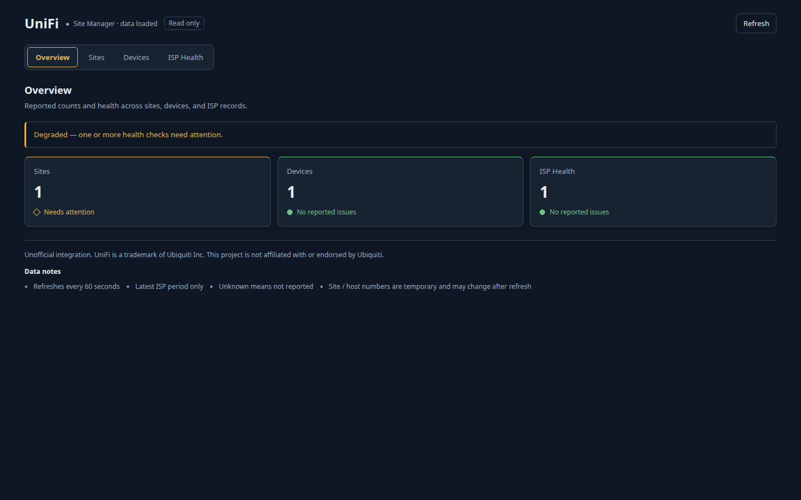
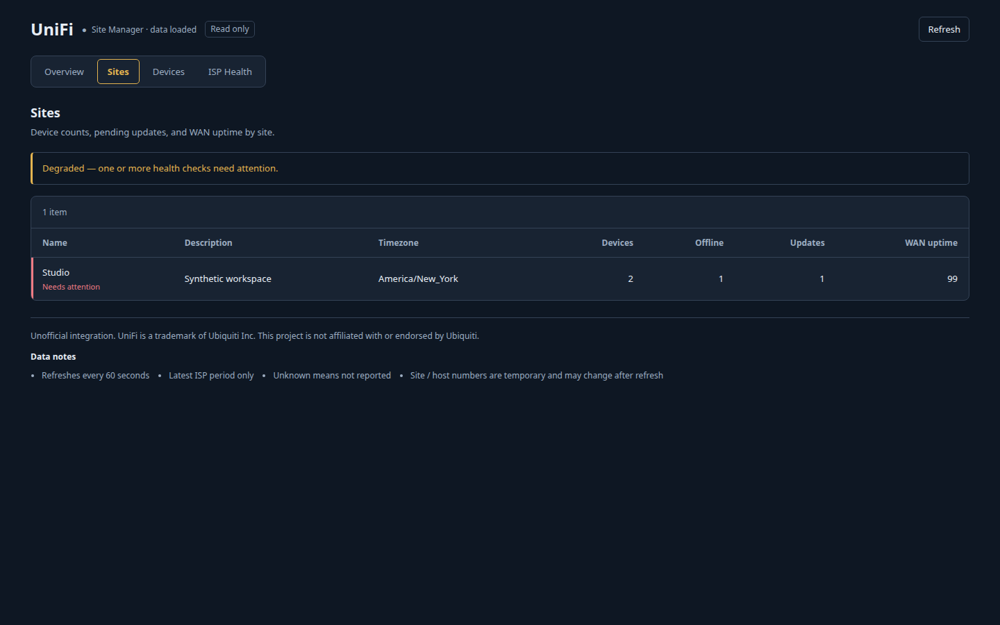
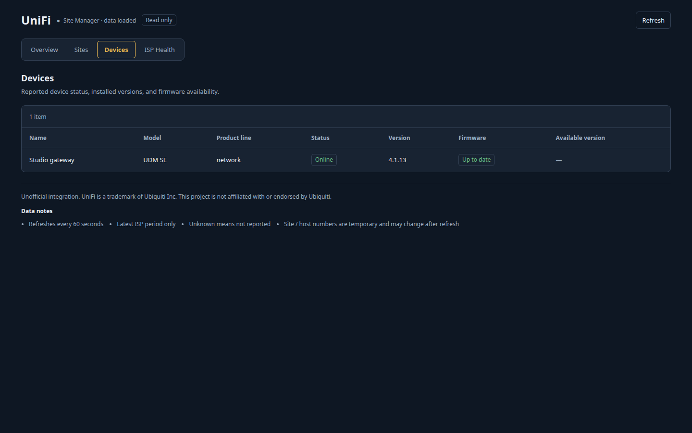
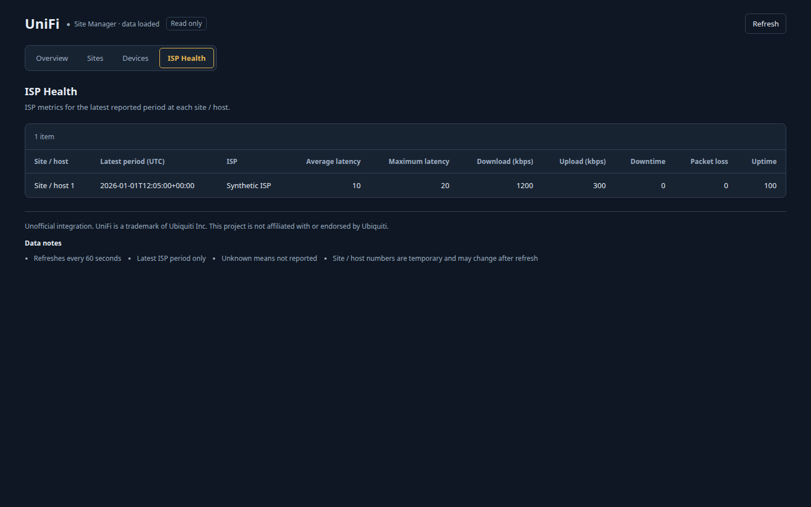

# Hermes UniFi

A read-only monitor for Hermes Desktop using the official UniFi Site Manager API. This unofficial integration shows site and device summaries and the latest 5-minute ISP metric period. Version 0.1.0 is the first public release.

[Install in Hermes](hermes://plugin/install?repo=Anunnaki-Astronaut/hermes-unifi&enable=1)



## What it shows

- Overview counts and reported health flags
- Sites, device totals, offline counts, and available updates
- Device state, model, installed firmware, and firmware availability
- The latest timestamped 5-minute ISP metric period per site/host pair

The page refreshes every 60 seconds. Unknown means not reported; missing values appear as an em dash.

## Current limits

This is not a troubleshooting assistant. It exposes no agent tool, cannot diagnose or repair a network by itself, and cannot change the network. There are no mutations, clients, MAC/IP output, stable raw identifiers, history, telemetry, exports, SSH, MCP, shell, or LLM features.

Sites and devices show only the first upstream page. When more data is available, a partial-data notice marks incomplete counts. Overview keeps available summaries if another endpoint fails. ISP data is only the latest period, not a historical chart.

Site / host numbers are temporary and may change after refresh. These labels are presentation-only row numbers, not device/site/host identities. Do not use them to correlate data across refreshes. Stable identifiers are deliberately suppressed.

Undefined units remain unlabeled rather than guessed: latency, downtime, uptime, and packet loss have no assumed unit. Download/upload labels follow the documented `kbps` field names.

## Screenshots

All screenshots use made-up data and do not show a real network. They are rendered from deterministic HTML previews of the Desktop component.

| Overview | Sites |
| --- | --- |
|  |  |

| Devices | ISP Health |
| --- | --- |
|  |  |

## Requirements

- Hermes Agent and Hermes Desktop >=0.22.2
- UniFi Site Manager access
- A Site Manager API key
- Backend internet access to `https://api.ui.com`

## Install

From Desktop, use **Install in Hermes** above or **Capabilities → Plugins → Install from Git**, entering `Anunnaki-Astronaut/hermes-unifi`. Review the source, select both **Desktop** and **Agent/backend**, confirm installation, and enable **UniFi**. The plugin is disabled by default unless enabled during installation.

From the command line on the backend host:

```sh
hermes plugins install Anunnaki-Astronaut/hermes-unifi --enable
```

With a remote backend, install the Desktop part on the computer running Desktop and install/enable the Agent/backend part on the backend host. CLI installation on the remote host still requires the local Desktop part. Installing only Desktop can produce `Plugin not found`.

See [the installation guide](docs/INSTALL.md) for setup and first-run verification. The public repository must be available before the install link and repository commands can work.

## Set up the API key

1. Sign in to `unifi.ui.com`.
2. Open **Settings → API Keys** and create a new API key.
3. Copy it when shown; it is shown only once. Store it securely.
4. In Hermes Desktop, select the intended backend/profile and open **Settings → Plugins → UniFi**.
5. Enter the key in the masked API-key field, save, and open **UniFi** from the sidebar.

Hermes stores the key for the selected profile as `UNIFI_API_KEY`. There is no endpoint setting. Do not paste the key into chat, URLs, JavaScript, screenshots, issues, or Git.

Official instructions: [Getting started with the official UniFi API](https://help.ui.com/hc/en-us/articles/30076656117655-Getting-Started-with-the-Official-UniFi-API) and [Site Manager API setup](https://developer.ui.com/site-manager-api/gettingstarted).

## Troubleshooting

- **Not configured:** Save the API key in the masked field for the backend/profile Desktop is using.
- **Plugin not found:** Install and enable the backend part on the connected Hermes host. Use `hermes plugins enable unifi` if it is installed but disabled.
- **Authentication failure (401/403):** Check that the key is a valid Site Manager API key for an account with access. Replace a revoked key through the masked field; never post it in an issue.
- **Rate limit (429):** Wait for the indicated cooldown before retrying. The backend respects a bounded `Retry-After` delay; repeated refreshes do not bypass it.
- **Older design:** Update the backend package, then use **Capabilities → Plugins → Rescan**, or restart Desktop. For remote setups, check both copies.
- **Missing or unknown fields:** API fields vary with Network version. Missing values are not inferred. Partial notices indicate first-page limits; undefined units remain unlabeled. Scrub any issue text or screenshots before sharing.

## Updating and removing

Run on the backend host:

```sh
hermes plugins update unifi
hermes plugins remove unifi
```

Use only the command for the action you intend. After updating, rescan in Desktop to refresh its local copy. Disable or remove the Desktop part through **Capabilities → Plugins**; remote installations have separate parts.

## Security and privacy

Only fixed GET requests under `https://api.ui.com/v1` are allowed: `/sites`, `/devices`, and `/isp-metrics/5m`. There is no configurable endpoint or arbitrary request surface. The API key is read through Hermes' scoped secret access and sent only in the backend `X-API-KEY` header; it is never exposed to Desktop JavaScript.

The backend suppresses stable identifiers, MAC/IP addresses, sensitive free text, and upstream error bodies. No controller payload is persisted. The plugin adds no telemetry or third-party services beyond the official API. Displayed labels can still be sensitive: scrub screenshots, issues, and logs before sharing.

See [SECURITY.md](SECURITY.md) for private vulnerability reporting and technical controls, and [PRIVACY.md](PRIVACY.md) for data handling.

## Development and verification

Use Python 3.11+ and Node 22+. In a development environment with dependencies from `requirements-dev.txt`:

```sh
python -m pytest -q
node --check desktop/plugin.js
node --check scripts/render_screenshot.cjs
for view in overview sites devices isp; do
  node --experimental-vm-modules scripts/render_screenshot.cjs "$view" "/tmp/$view.html"
  cmp "/tmp/$view.html" "docs/screenshots/$view.html"
done
hermes plugins doctor . --ci
git diff --check
```

Tests block socket connections and DNS and mock transports. The preview renderer uses synthetic fixtures without network primitives. The four checked-in HTML previews are screenshot sources, not captures of a live network. See [CONTRIBUTING.md](CONTRIBUTING.md).

## Project status and license

0.1.0 is the first public release. Monitoring remains read-only. Future write controls or agent tools require separate design and security approval.

MIT. Copyright Hermes UniFi contributors. See [LICENSE](LICENSE) and [CHANGELOG.md](CHANGELOG.md).

Unofficial integration. UniFi is a trademark of Ubiquiti Inc. This project is not affiliated with or endorsed by Ubiquiti.
